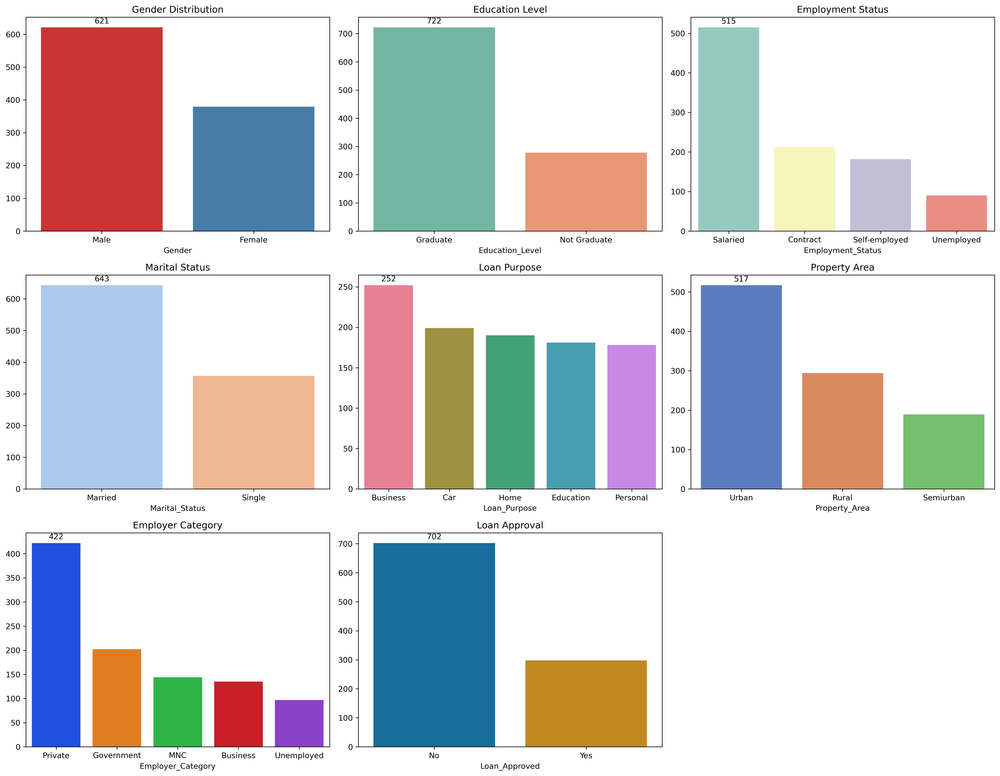
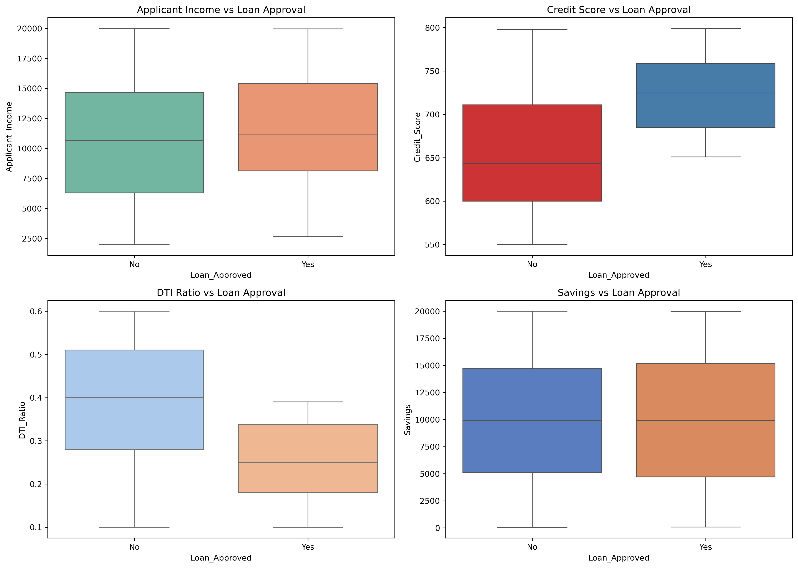
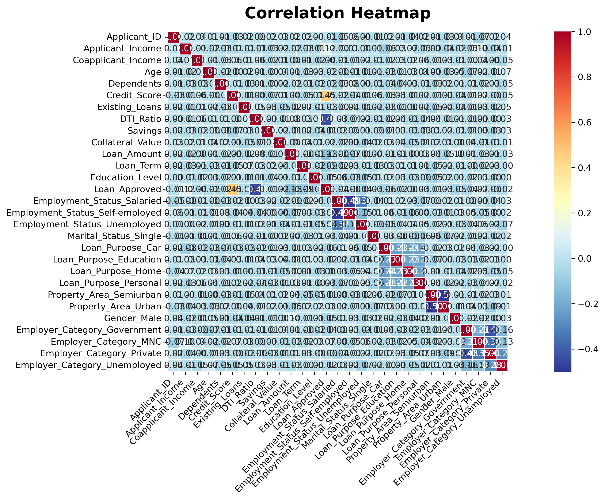
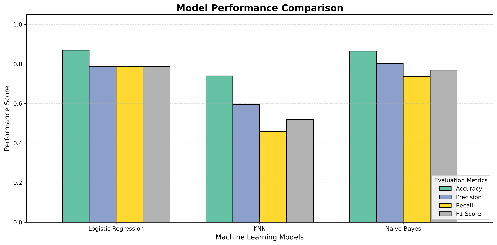

# 💳 Credit-Wise Loan Approval System

A Machine Learning Classification Project that analyzes applicant financial information and predicts loan approval outcomes using multiple classification algorithms.

## 📌 Project Overview

The **Credit-Wise Loan Approval System** is a Machine Learning minor project developed using Python. It focuses on analyzing loan applicant data, performing Exploratory Data Analysis (EDA), preprocessing features, and building classification models to predict loan approval decisions.

The project compares Logistic Regression, K-Nearest Neighbors (KNN), and Gaussian Naive Bayes to understand and evaluate their predictive performance.

## 🎯 Objectives

- Understand and analyze the loan approval dataset.
- Perform data cleaning and preprocessing.
- Handle missing values and encode categorical features.
- Conduct Exploratory Data Analysis (EDA).
- Visualize relationships between financial attributes.
- Train multiple Machine Learning classification models.
- Compare model performance using evaluation metrics.

## 🛠️ Technologies Used

| Technology | Purpose |
|---|---|
| Python | Programming Language |
| Pandas | Data manipulation |
| NumPy | Numerical operations |
| Matplotlib | Data visualization |
| Seaborn | Statistical visualization |
| Scikit-learn | Machine Learning |
| Jupyter Notebook | Development environment |

## 📂 Project Structure

```text
Credit-Wise-Loan-Approval-System/
│
├── CreditWise Loan System.pdf
├── credit-wise-loan-system.ipynb
├── loan_approval_data.csv
├── requirements.txt
├── categorical-analysis.png
├── income-financial-analysis.png
├── correlation-heatmap.png
├── model-performance-comparison.png
└── README.md
```

## 🔍 Exploratory Data Analysis (EDA)

Exploratory Data Analysis is performed to understand the distribution of applicant information and identify patterns in the dataset.

### 1. Categorical Analysis

This visualization shows the distribution of categorical features in the loan approval dataset.



### 2. Income and Financial Analysis

These boxplots compare Applicant Income, Credit Score, DTI Ratio, and Savings across loan approval categories. They help identify financial patterns associated with loan approval decisions.



### 3. Correlation Heatmap

The correlation heatmap illustrates relationships between numerical features. It helps identify positive and negative correlations among financial attributes.



## 🤖 Machine Learning Algorithms

The following classification algorithms are implemented:

1. **Logistic Regression** – A classification algorithm used to predict binary outcomes.
2. **K-Nearest Neighbors (KNN)** – Classifies data points based on their nearest neighbors.
3. **Gaussian Naive Bayes** – A probabilistic classification algorithm based on Bayes' theorem.

## 📊 Model Performance Comparison

The models are compared using different evaluation metrics to understand their classification performance.



## 📈 Model Evaluation Metrics

The following metrics are used to evaluate the trained models:

- **Accuracy:** Measures the overall correctness of predictions.
- **Precision:** Measures how many predicted approvals are actually correct.
- **Recall:** Measures how many actual positive cases are correctly identified.
- **F1 Score:** Represents the balance between precision and recall.
- **Confusion Matrix:** Shows correct and incorrect classification results.

## ⚙️ Project Workflow

1. Data Loading
2. Data Inspection
3. Missing Value Handling
4. Exploratory Data Analysis
5. Categorical Feature Encoding
6. Correlation Analysis
7. Train-Test Split
8. Feature Scaling
9. Model Training and Prediction
10. Model Evaluation and Comparison

## 🚀 How to Run the Project

**Step 1: Clone the repository**

```bash
git clone https://github.com/TasneemFatma012/Credit-Wise-Loan-Approval-System.git
```

**Step 2: Navigate to the project directory**

```bash
cd Credit-Wise-Loan-Approval-System
```

**Step 3: Install dependencies**

```bash
pip install -r requirements.txt
```

**Step 4: Open Jupyter Notebook**

```bash
jupyter notebook
```

Open `credit-wise-loan-system.ipynb` and run the cells sequentially.

## 📌 Project Type

Machine Learning | Classification | Exploratory Data Analysis | Minor Project

## 👩‍💻 Author

**Tasneem Fatma**

MCA Student | Aspiring Software Developer | Machine Learning Enthusiast

- GitHub: [TasneemFatma012](https://github.com/TasneemFatma012)
- Project Repository: [Credit-Wise-Loan-Approval-System](https://github.com/TasneemFatma012/Credit-Wise-Loan-Approval-System)

---

⭐ If you find this project interesting, feel free to explore the repository!
